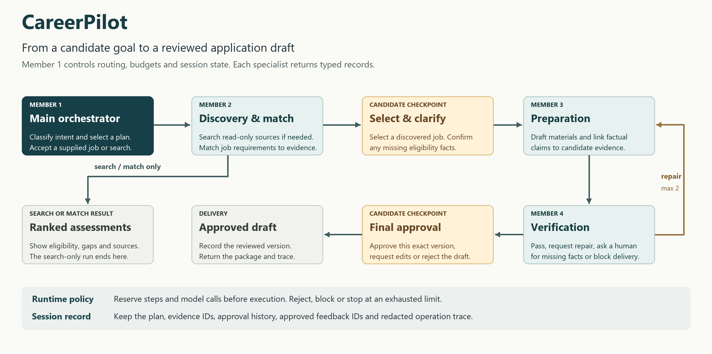

# CareerPilot

**CA6123 · Member 1 · Workflow and integration**

CareerPilot helps a candidate decide which job to pursue and prepares an evidence-linked draft for their review. A request to find roles ends with ranked assessments. Supplying a job for an application takes a shorter route through matching, clarification, drafting and approval.

[Open the walkthrough](demo.ipynb) · [View the architecture](docs/architecture.png) · [Specialist handoff](docs/integration.md) · [Source and contribution record](docs/provenance.md)



## Run the walkthrough

From this directory on Windows, start JupyterLab with Python 3.12. The initial setup installs the notebook and replay dependencies.

```powershell
py -3.12 -m venv .venv
.\.venv\Scripts\python -m pip install -r requirements-demo.txt
.\.venv\Scripts\python -m jupyterlab demo.ipynb
```

Select **Run All Cells** for the recorded example. For a live classroom rehearsal, change `INTERACTIVE` to `True` in the setup cell, restart the kernel and answer the fictional candidate's checkpoints. All three job records and all candidate evidence are local fixtures.

For Colab, open the notebook from GitHub, then run these setup lines in a new first cell on a fresh runtime.

```python
!git clone --depth 1 https://github.com/raederhans/CareerPilot.git /content/CareerPilot
%cd /content/CareerPilot
%pip install -q -r requirements.txt
```

## Use another job catalogue and profile

Supply your own normalized job and evidence files. The catalogue determines which roles, locations, requirements and application questions are available. The matcher joins a requirement to evidence by its `fact_key`. Missing or contradictory evidence produces a clarification question.

```python
from careerpilot.catalog import load_evidence, load_jobs
from careerpilot.orchestrator import Orchestrator
from careerpilot.replay import ReplayDiscovery, ReplayPreparation, ReplayVerification

flow = Orchestrator(ReplayDiscovery(load_jobs("local-data/jobs.json")),
                    ReplayPreparation(), ReplayVerification())
profile = load_evidence("local-data/profile.json")
results = flow.start("Find two editorial assistant roles in Melbourne", profile)
for match in results.matches:
    print(match.job_id, match.eligibility, match.gaps)
```

Use the bundled [jobs](data/sample_jobs/jobs.json) and [profile](data/sample_profiles/synthetic_candidate.json) for the JSON shape. Keep personal files in the ignored `local-data/` directory. Each job can define its own factual conditions and ATS questions. [Integration contract](docs/integration.md)

## What to observe

1. Search the Singapore catalogue with an experience ceiling. Two records have an unresolved eligibility question, and one exceeds that ceiling. Try narrowing the target role to see the candidate pool change.
2. Prepare an application for the supplied AI Engineering Intern job. The trace skips discovery and the workflow stops before drafting to ask about work authorisation. Restarting from a saved checkpoint preserves this decision.
3. Answer yes, inspect the draft and its evidence IDs, then approve the reviewed version. A no answer blocks preparation. Edits require a new review and a new approval.

## Implementation and integration

| Component | Location |
| --- | --- |
| Four intents, shared data models and specialist protocols | [Schemas](careerpilot/schemas.py) |
| Intent classifier, ADK adapter and classification examples | [Classifier](careerpilot/intent.py) · [Prompt](careerpilot/prompts/intent.md) |
| Routing, repair limits and human checkpoints | [Orchestrator](careerpilot/orchestrator.py) |
| Session state, approval records, budget and redacted trace | [Session](careerpilot/session.py) · [Configuration](careerpilot/config.py) |
| Local substitutes for Members 2–4 and synthetic inputs | [Matching](careerpilot/matching.py) · [Drafting and review](careerpilot/replay.py) · [Fixtures](data/) |

Construct `Orchestrator(discovery, preparation, verification)` with each member's implementation when available. The baseline uses replay adapters for all three specialists. Live search, evidence retrieval, full claim verification and the feedback store belong to their respective team modules.

## Run the tests

```powershell
.\.venv\Scripts\python -m pytest -q
```

A tests-only environment needs `requirements.txt`. The optional ADK tests use a local fake model and skip automatically when the SDK is absent.

## Course model connection

The notebook defaults to replay. The optional classifier uses Google ADK; `requirements-live.txt` pins the SDK version used for the local adapter checks. Confirm the course's approved model, compatible SDK version and token allocation before a live run.

```powershell
.\.venv\Scripts\python -m pip install -r requirements-live.txt
```

Provide `CAREERPILOT_MODE=live`, `CAREERPILOT_MODEL` and a positive `CAREERPILOT_MAX_MODEL_CALLS` in the environment. Set up the course-approved Google SDK authentication separately. Pass `config=RuntimeConfig.from_env()` when constructing the orchestrator. The optional adapter changes intent classification. The supplied specialists continue to replay until replaced.

The default session allows 12 agent operations and at most two repairs. Each session has its own model-call allowance. Each live intent classification makes at most one request, with HTTP retries disabled. Track the course-wide token allocation across team runs.

## Course dates

The team targets integration on 29 November and packaging on 3 December. Video and source are due **4 December 2026 at noon Singapore time**. The presentation is one continuous video of at most 12 minutes. All four members appear and narrate their own sections. Append the group number to the submitted source filename. Individual peer evaluation is due **8 December at noon**.
